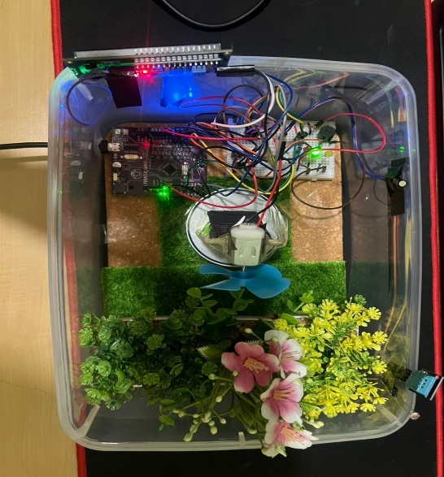
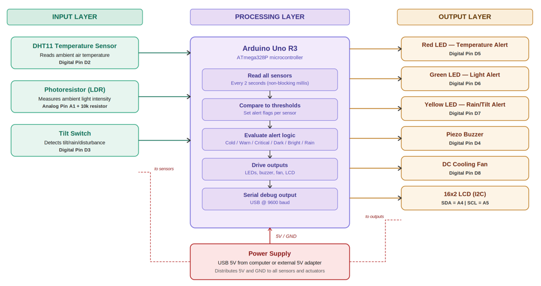
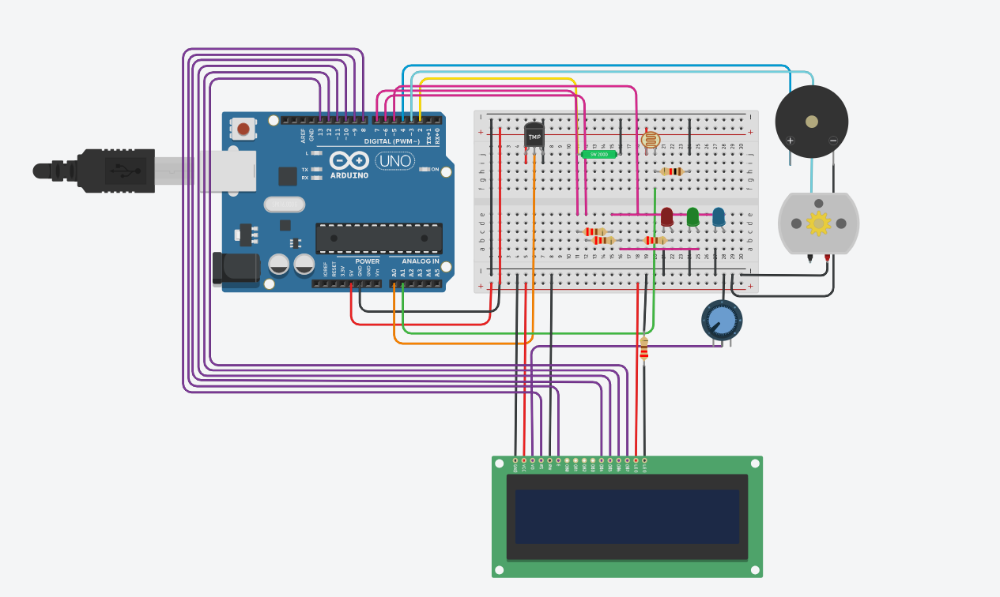
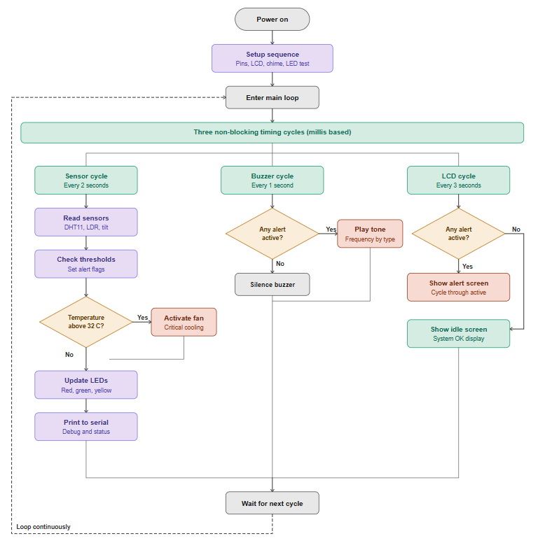
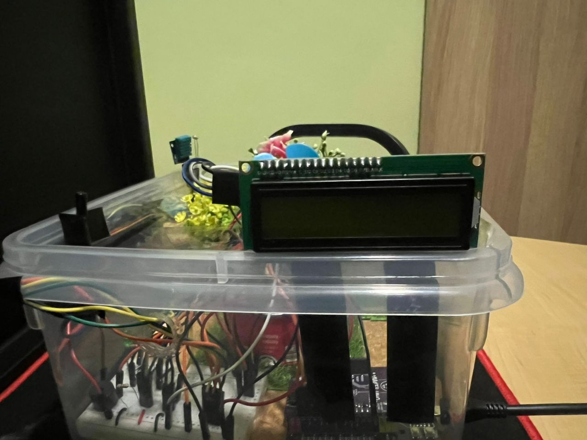
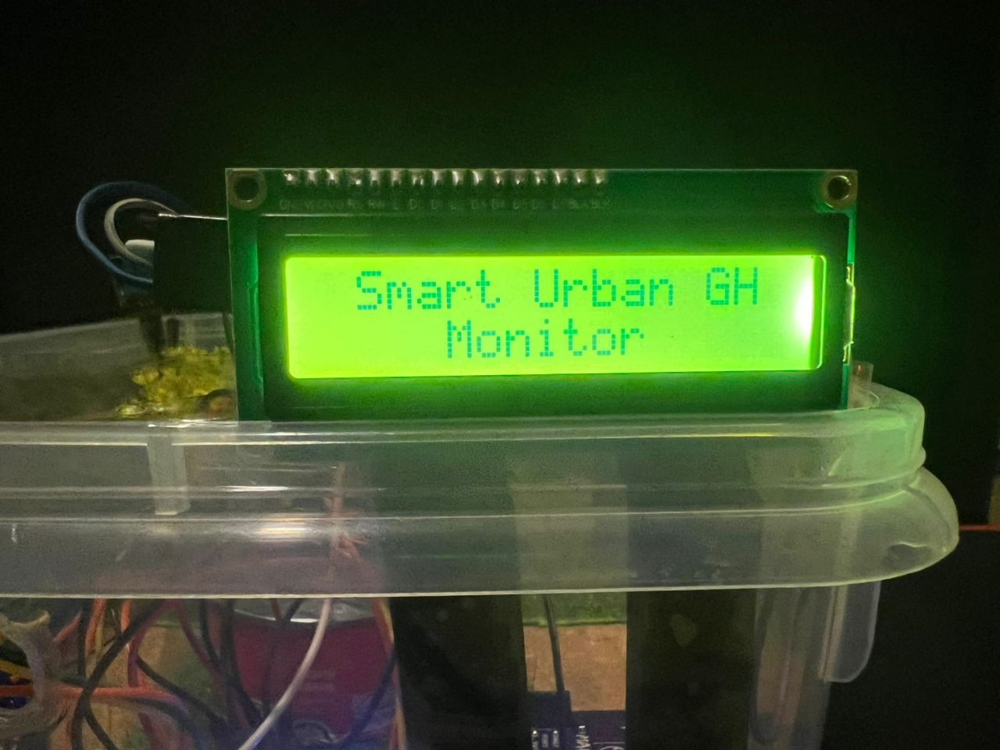
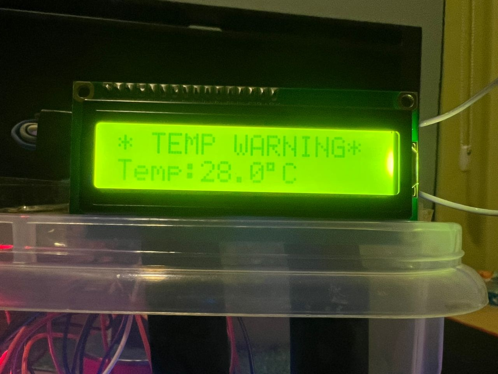
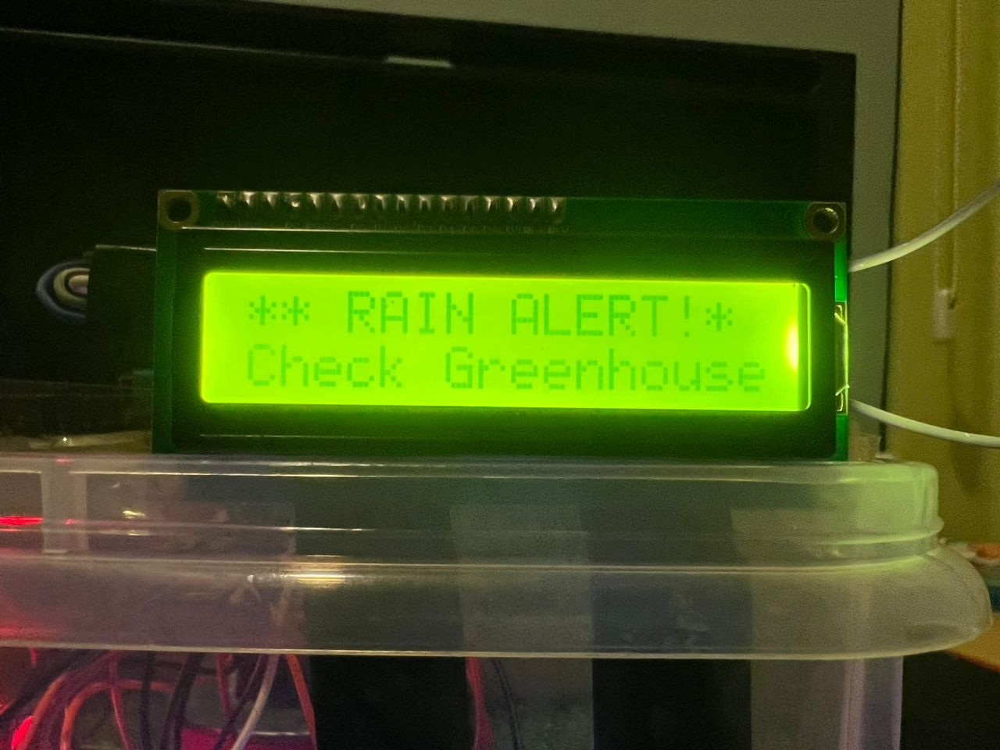
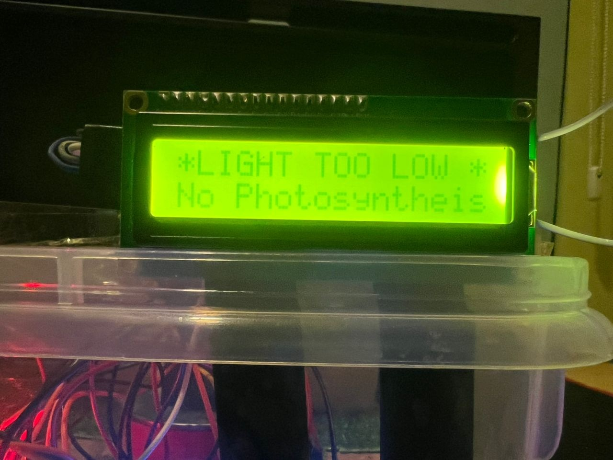
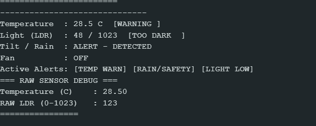

# 🌱 Smart Urban Greenhouse Monitor
### Arduino-Based Environmental Monitoring & Automated Alert System

   

**Individual IoT Project | Asia Pacific University of Technology & Innovation | 2026**

## 📌 Overview

**Smart Urban Greenhouse Monitor** is an individually developed, Arduino Uno–based prototype for monitoring greenhouse conditions and responding to environmental risks. It combines temperature and humidity sensing, ambient light monitoring, and tilt-based disturbance simulation with visual, audible, and automated cooling responses.

I designed, assembled, programmed, and documented the physical prototype for the *Internet of Things: Concepts and Applications* module. The aim was to demonstrate a low-cost approach to greenhouse monitoring and automation in an urban agriculture context.



## ✨ Key Features

- **Temperature and humidity monitoring:** DHT11 sensor provides environmental readings.
- **Ambient light assessment:** Photoresistor (LDR) flags unusually dark or bright conditions.
- **Disturbance simulation:** Tilt switch triggers a rain/disturbance alert; it does **not** measure precipitation directly.
- **Automatic cooling:** A DC fan is switched on when temperature reaches the critical threshold.
- **Visual indicators:** Red, green, and yellow LEDs indicate temperature, light, and tilt alerts respectively.
- **Audible alerts:** Passive buzzer produces different tones for different alert categories.
- **Live LCD status:** 16×2 I²C LCD alternates between status and active alert messages.
- **Concurrent alert handling:** Multiple conditions can be active while the LCD cycles through alerts.
- **Serial diagnostics:** Real-time sensor and alert information is reported over serial.

## 🏗️ System Architecture

The project follows a **sensor → microcontroller → actuator/display** architecture. The Arduino reads environmental inputs, compares values against programmed thresholds, and controls alert outputs.



### Hardware components

| Component | Role |
|---|---|
| Arduino Uno R3 | Central controller |
| DHT11 | Temperature and humidity sensing |
| Photoresistor (LDR) | Ambient light measurement |
| Tilt switch (SW-520D) | Simulated rain / physical disturbance detection |
| 5V DC cooling fan | Cooling response for critical temperature |
| 16×2 I²C LCD | Status and alert messages |
| Passive buzzer | Distinct audible warning patterns |
| Red, green, yellow LEDs | Category-specific visual alerts |
| Breadboard, resistors, jumper wires | Prototype connections |

## 🔌 Circuit Design



### Arduino pin mapping

| Device | Arduino connection |
|---|---|
| DHT11 data | D2 |
| Tilt switch | D3 |
| Buzzer | D4 |
| Red LED | D5 |
| Green LED | D6 |
| Yellow LED | D7 |
| Cooling fan control | D8 |
| LDR analog output | A1 |
| I²C LCD SDA | A4 |
| I²C LCD SCL | A5 |

**Hardware note:** The academic prototype directly connected the fan control to D8. For a robust real-world build, the fan should be driven using a suitably rated transistor/MOSFET driver, flyback protection where appropriate, and an appropriate power supply rather than directly from a microcontroller GPIO pin.

## 📊 Environmental Thresholds

The following thresholds are those documented in my assignment, rather than universal values for all crops.

| Sensor | Condition | Threshold / state | Response |
|---|---|---|---|
| Temperature | Too cold | Below 15°C | Red LED, low-frequency buzzer, LCD alert |
| Temperature | Ideal | 20–25°C | Normal status |
| Temperature | Warning | 28–31°C | Red LED, warning buzzer, LCD alert |
| Temperature | Critical | 32°C or higher | Red LED, cooling fan, urgent buzzer, LCD alert |
| Light | Too dark | LDR below 100 | Green LED, LCD warning |
| Light | Ideal | LDR 200–800 | Normal light status |
| Light | Too bright | LDR above 800 | Green LED, LCD warning |
| Tilt | Disturbance | Switch triggered | Yellow LED, buzzer, LCD alert |

Threshold gaps between stated ranges are handled by the project logic; the table summarizes the principal documented bands.

## 🔄 Control Logic

The program uses `millis()`-based non-blocking scheduling to manage several recurring tasks:

| Task | Interval |
|---|---|
| Sensor readings | 2 seconds |
| LCD alert rotation | 3 seconds |
| Buzzer timing | 1 second |

This structure allows the system to monitor inputs while cycling through active alerts without relying on a single long blocking delay.



## 📸 Physical Prototype & Testing

### Prototype construction

The system was assembled using an Arduino Uno, breadboard, sensors, outputs, and a transparent enclosure representing a miniature greenhouse.



### Normal operation

With no active warnings, the LCD displays the system's normal status and the alert outputs remain off.



### Temperature warning

The LCD displays a temperature warning when the temperature rises above the desired range. At the critical threshold of **32°C**, the design activates the cooling fan.



### Simulated rain / disturbance alert

Triggering the tilt switch activates the yellow LED, audible alert, and LCD notification.



### Low light alert

The photoresistor triggers an alert when the ambient light reading is too low for the configured range.



### Serial monitor diagnostics

The serial output displays environmental measurements, system states, and currently active alerts.



## 🛠️ Software & Engineering Concepts

- Arduino IDE and Arduino C/C++
- `DHT.h`, `Wire.h`, and `LiquidCrystal_I2C.h`
- Modular setup, sensor-reading, alert, and display functions
- Named threshold constants for easier calibration
- Non-blocking timing with `millis()`
- Digital input/output, analog-to-digital conversion, and I²C communication
- Breadboard prototyping and hardware troubleshooting

## ⚠️ Limitations

- **No wireless connectivity:** The prototype operates locally without a mobile or cloud dashboard.
- **Simulated rain detection:** The tilt switch detects motion, not rainfall.
- **No persistent data logging:** Measurements are not retained after power-off.
- **Single-zone coverage:** One sensor set represents the greenhouse environment.
- **Fan driving constraints:** The report notes voltage disturbances from direct fan control; a dedicated driver is recommended for future hardware revisions.

## 🚀 Future Improvements

- Upgrade to ESP32 for Wi-Fi/Bluetooth communication.
- Add a dedicated rain sensor and soil moisture sensing.
- Store timestamped measurements using an SD card or other persistent storage.
- Extend to multiple greenhouse zones.
- Build a web dashboard with graphs and configurable thresholds.
- Improve actuator power isolation and electrical protection.

## 📁 Repository Contents

```text
Smart-Urban-Greenhouse-Monitor/
├── README.md
├── system-block-diagram.png
├── circuit-diagram.png
├── system-flowchart.png
├── prototype-front.jpg
├── prototype-interior.jpg
├── normal-condition.jpg
├── temperature-warning.jpg
├── rain-alert.jpg
├── light-alert.jpg
└── serial-monitor.png
```

**Source code availability:** This repository package contains documentation and actual project evidence extracted from my assignment. The original Arduino `.ino` source file is not included in the uploaded report as an executable file and should be added separately before presenting the repository as ready to compile or deploy.

## 🎓 Academic Details

**Project:** Smart Urban Greenhouse Monitor  
**Developer:** Fairouz Abdulrahman Hamed Mousa  
**Module:** CT101-3-3-IOT — Internet of Things: Concepts and Applications  
**Institution:** Asia Pacific University of Technology & Innovation (APU)  
**Year:** 2026  
**Project type:** Individual assignment and physical prototype

## 🔗 Prototype Circuit

[Tinkercad prototype circuit](https://www.tinkercad.com/things/jfexgDVNPBJ-ingenious-allis/editel?returnTo=https%3A%2F%2Fwww.tinkercad.com%2Fdashboard%2Fdesigns%2Fall&sharecode=l1f6hBfhbpaSRI-9nSRlfw3MWfxO_g0Bx)

---

**🌱 Smart Urban Greenhouse Monitor — Applying embedded systems and IoT principles to sustainable urban agriculture.**
